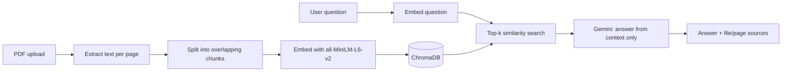

# 📚 Ask My Notes

**A retrieval-augmented generation (RAG) app that answers questions about your PDFs, with page-level citations.**

Upload documents, ask a question in plain English, and get an answer grounded in your files. The model is instructed to answer only from the retrieved passages, so when the answer isn't in your documents it says so instead of guessing.

[**Live demo**](YOUR_STREAMLIT_APP_URL) · [Report an issue](YOUR_GITHUB_REPO_URL/issues)

> **No API key or sign-up needed to try it.** Open the demo, upload a PDF, and ask a question. The key is configured on the server.


<!-- Replace with a screenshot or GIF of the app. Make sure no API key is visible. -->


---

## Features

- **Grounded answers with citations:** every answer lists the source file and page it came from.
- **Refuses out-of-scope questions:** answers only from the retrieved context, and says "I don't know" otherwise.
- **Multi-PDF support:** upload several documents and query across all of them.
- **Measured retrieval quality:** chunking settings were chosen using a labelled evaluation set (see [Evaluation](#evaluation)).
- **Local embeddings:** semantic search runs locally with sentence-transformers, so no embedding API calls are needed.
- **Persistent index:** the vector store is saved to disk, so documents stay searchable across restarts.

## How it works



1. **Ingest:** text is extracted page by page and split into overlapping chunks. Each chunk keeps its file name and page number.
2. **Index:** chunks are embedded with `all-MiniLM-L6-v2` (384 dimensions) and stored in ChromaDB using cosine similarity.
3. **Retrieve:** the question is embedded and the most similar chunks are fetched.
4. **Generate:** the retrieved chunks are sent to Gemini with an instruction to answer only from that context and return structured JSON.
5. **Cite:** the interface shows the answer plus the retrieved passages and their pages.

## Tech stack

| Layer | Tool |
|---|---|
| Language | Python |
| PDF parsing | pypdf |
| Embeddings | sentence-transformers (`all-MiniLM-L6-v2`) |
| Vector store | ChromaDB |
| LLM | Google Gemini API |
| Interface | Streamlit (deployed), Gradio (local alternative) |
| Hosting | Streamlit Community Cloud |

## Evaluation

I wrote **30 questions** over a 15-page AI course module (problem-solving agents and search algorithms), each labelled with the page containing the answer. The metric is **hit rate@k**: how often the correct page appears among the top-k retrieved chunks.

| Chunk size / overlap | hit@1 | hit@3 | hit@5 |
|---|---|---|---|
| 500 / 50 | 0.73 | 0.97 | 1.00 |
| **1000 / 150** | 0.63 | **1.00** | 1.00 |
| 1500 / 200 | 0.67 | 0.93 | 0.97 |

**Chosen setting: 1000 / 150.** It retrieves the correct page within the top 3 results for every test question. Smaller chunks rank the right page first more often, but miss more at k=3, and the app sends several chunks to the model anyway.

**Out-of-scope questions:** 6 questions not covered by the document (including 4 on related topics such as A* and alpha-beta pruning) were all answered with "I don't know".

**Limitations:** the test set is small and self-written, covers a single document, and measures retrieval only, not answer quality. Results may differ on other document types.

Reproduce the results:

```bash
python eval.py            # retrieval hit rate by chunk size
python eval_refusal.py    # out-of-scope refusal test
```

## Run your own copy (for developers)

Using the live demo requires nothing. The steps below are only for running or deploying your own copy of the project, where the app owner supplies a Gemini key on the server. Visitors are never asked for a key.

### Prerequisites

- Python 3.10 or newer
- A [Google AI Studio](https://aistudio.google.com/) API key (for the person hosting the app, not for its users)

### Installation

```bash
git clone YOUR_GITHUB_REPO_URL
cd ask-my-notes
python -m venv venv
venv\Scripts\activate          # macOS/Linux: source venv/bin/activate
pip install -r requirements.txt
```

### Server configuration

The app reads the key from the server environment, so the interface never asks users for one. For local development, create a `.env` file in the project root:

```
GEMINI_API_KEY=your-key-here
```

The `.env` file is listed in `.gitignore`. Never commit your key.

### Run

```bash
streamlit run streamlit_app.py
```

Then open `http://localhost:8501`, upload a PDF, click **Index documents**, and ask a question.

A Gradio version of the interface is also included: `python app.py`.

## Project structure

```
ask-my-notes/
├── streamlit_app.py     # Streamlit interface (deployed version)
├── app.py               # Gradio interface (local alternative)
├── ingest.py            # PDF text extraction and chunking
├── store.py             # Embeddings and ChromaDB storage/retrieval
├── rag.py               # Prompt building and Gemini answer generation
├── index.py             # Index a PDF from the command line
├── eval.py              # Retrieval evaluation (hit rate@k)
├── eval_refusal.py      # Out-of-scope refusal test
└── requirements.txt
```

## Deployment

The app is deployed on [Streamlit Community Cloud](https://streamlit.io/cloud):

1. Push the repository to GitHub (without `.env`, `db/` or `docs/`).
2. Create a new app on Streamlit Cloud pointing to `streamlit_app.py`.
3. Add the key under **Settings → Secrets**:
   ```
   GEMINI_API_KEY = "your-key-here"
   ```

## Privacy note

On the public demo, uploaded documents go into a **shared** collection, so other visitors' questions can retrieve them. Please upload only non-sensitive files. The demo also limits the number of questions per session to protect API quota.

## Roadmap

- Per-session document collections for private uploads
- Re-ranking retrieved chunks to improve precision at k=1
- Answer-quality evaluation (faithfulness and relevance), not just retrieval
- A LangChain or LlamaIndex version for side-by-side comparison

## Author

**Karan Pandya**, B.E. Artificial Intelligence and Machine Learning, BMS Institute of Technology and Management

[LinkedIn](YOUR_LINKEDIN_URL) · [GitHub](YOUR_GITHUB_URL) · karanpandya662@gmail.com
